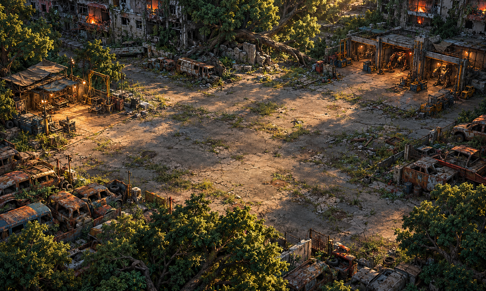

# INERTES — Chuva de Ferro

Protótipo de RPG de ação 2D criado por Gustavo Lameiras. Em uma cidade devastada por uma revolta das máquinas, dois sobreviventes recuperam recursos e se fundem a robôs para enfrentar a ameaça.



## Versão atual: 0.6

- Escolha entre dois protagonistas; o outro acompanha e ajuda no combate.
- Combate em tempo real, esquiva e fusão com bípede, flutuante ou Cérbero.
- Depósito de farm com ondas de inimigos, ferragens, regeneração, kits e munição.
- Relógio, anoitecer e máquinas com maior percepção durante a noite.
- Cenários ilustrados, efeitos de luz, sombras, fumaça e brasas.

## Executar

1. Clone ou baixe este repositório e extraia os arquivos.
2. No Godot 4, clique em **Importar** e selecione `project.godot`.
3. Aguarde a importação dos recursos e pressione **F5**.

O projeto foi usado no Godot 4.7.2; os testes automatizados foram executados no Godot 4.5.1 com o renderizador Compatibility.

| Tecla | Ação |
| --- | --- |
| WASD / setas | Mover |
| J | Atacar |
| Espaço | Esquivar |
| E | Interagir / fundir / usar bancada |
| F | Entrar ou sair do depósito junto ao portal |
| R | Usar kit médico |
| Esc | Pausar |

## Estrutura

- `scripts/`: regras, combate, interface e ambiente.
- `cenas/` e `main.tscn`: cenas do Godot.
- `assets/`: personagens, máquinas e itens.
- `assetscenarios/`: cenários ilustrados.
- `tests/`: verificações automatizadas.

Leia [GUIA-0.6.md](GUIA-0.6.md) para detalhes dos itens, ciclo dia/noite e profundidade.

## Testes

Com `godot` disponível no terminal:

```sh
godot --headless --path . --editor --import --quit
godot --headless --path . --script res://tests/smoke.gd
godot --headless --path . --script res://tests/dupla.gd
godot --headless --path . --script res://tests/movimento.gd
godot --headless --path . --script res://tests/farm.gd
godot --headless --path . --script res://tests/ciclo.gd
```

## Em desenvolvimento

O jogo ainda é um protótipo. As artes usam poses com movimentos por transformação; não há ciclos completos de animação. A profundidade usa um recorte frontal da copa, e as colisões ainda precisam de refinamento. Reparos individuais dos robôs, salvamento da campanha e inspeção visual completa continuam pendentes.

## Fluxo de atualização

Cada alteração deve ser testada e registrada em commit descritivo. Código e recursos ficam no Git; caches `.godot/`, exportações e temporários ficam fora do repositório.
